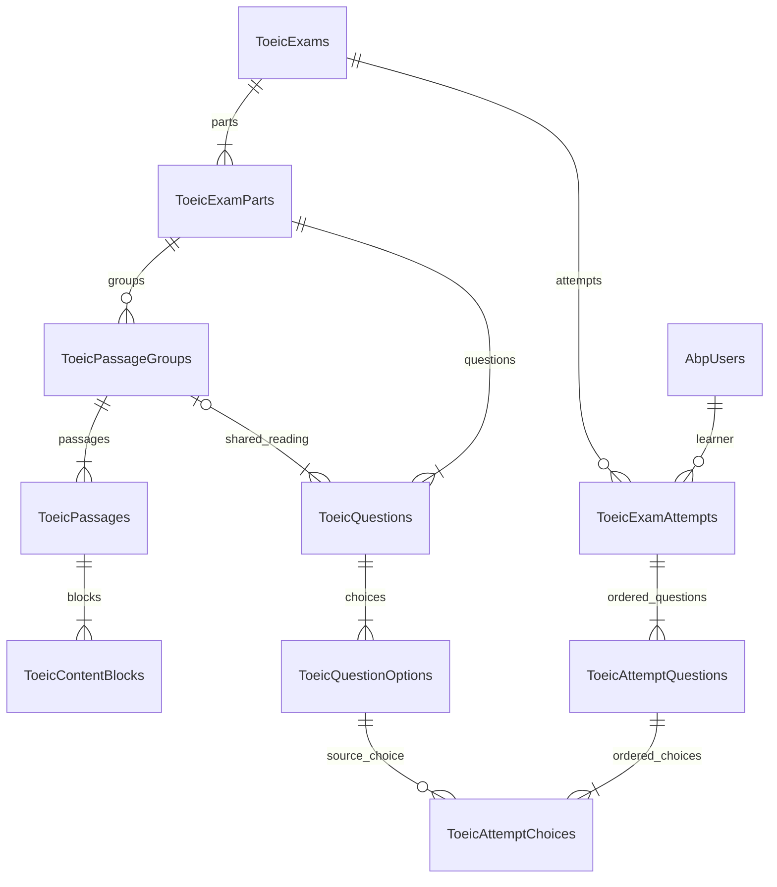

# Database TOEIC Reading

Database phát triển mới: `ToeicReadingDb`, instance `LAPTOP-AGT05BF0\SQLEXPRESS` (tên local `.\SQLEXPRESS`). Windows Authentication đã được kiểm chứng bằng tài khoản Windows của tiến trình ngoài sandbox. Kết nối bật `Encrypt=True;TrustServerCertificate=True` cho SQL Server local.

Database cũ `NguyenTatKhoa_2380601071ToeicDb` được giữ nguyên. Yêu cầu trực tiếp lần này là tạo database mới nên chọn tên mới chưa tồn tại. Không sao chép đề TEST từ database cũ.

## Cài và chạy lại

Từ PowerShell Windows với tài khoản có quyền SQL Server:

```powershell
powershell.exe -NoProfile -ExecutionPolicy Bypass -File "E:\flutter_application_1\scripts\setup-toeic-database.ps1" -RunChecks
```

`-Server` và `-DatabaseName` có thể truyền riêng. Script dùng SDK .NET 9 local nếu có; tool manifest ghim `dotnet-ef` 9.0.5, cùng phiên bản provider EF Core. Chỉ một setup được chạy trên một đích. Script kiểm tra quyền sở hữu database qua extended property `TOEIC.Project`; database có sẵn không mang dấu project sẽ bị từ chối, không tự thêm bảng vào database lạ.

Luồng áp dụng chính là **EF migrations**. File `TOEIC_Database.sql` chỉ là bản xuất idempotent để kiểm tra/chạy thủ công khi cần; không chạy đồng thời cả hai cách. File SQL không tạo database và không chứa `USE`: chọn database ứng dụng đã được setup đánh dấu trước khi chạy. Header chặn database hệ thống/đích không có dấu sở hữu. Nếu bị chặn, mở kết nối SSMS mới trước khi thử lại.

Trong SSMS: Server `.\SQLEXPRESS`, Windows Authentication, Encrypt Mandatory, Trust Server Certificate, Connect → Databases → Refresh → `ToeicReadingDb` → Tables.

Script ghi cấu hình vào `appsettings.Local.json` của Web.Mvc, Web.Host và Migrator, được loại khỏi git. Key thật là `ConnectionStrings:Default`. Environment variable `ConnectionStrings__Default` có ưu tiên cao nhất và được dùng chung bởi CLI, utility và backend. Mẫu không chứa mật khẩu: `appsettings.Local.example.json`.

## Cấu trúc và ánh xạ

Giữ ASP.NET Boilerplate 10.2.0, namespace `NguyenTatKhoa_2380601071`, .NET 9 và EF Core 9.0.5. Tái sử dụng 7 bảng TOEIC có sẵn, bổ sung 3 bảng; không dựng bộ bảng nghiệp vụ thứ hai.

| Khái niệm | Bảng SQL | Cột/quan hệ chính |
|---|---|---|
| Đề | ToeicExams | GUID; Code duy nhất; SourceExamId, TagVersion, Directions, DeclaredQuestionCount, source SHA-256, Draft/Published/Archived, audit và rowversion |
| Phần | ToeicExamParts | FK ExamId; PartNumber 5/6/7; Directions; DisplayOrder; AllowShuffleGroups |
| Nhóm | ToeicPassageGroups | FK ghép ExamPartId/ExamId/Part; ExternalId (SourceGroupId); dải câu; thứ tự; cờ nguồn |
| Tài liệu | ToeicPassages | FK nhóm; SourcePassageId; Kind; thứ tự; BlankQuestionNumbers JSON text có cấu trúc |
| Khối | ToeicContentBlocks | FK ghép PassageId/PassageGroupId; SourceBlockId; DocumentKey; thứ tự; text/image/table; BinaryData varbinary(max), MediaType, SourcePage |
| Câu | ToeicQuestions | FK phần và nhóm; SourceQuestionId có scope trong đề; OriginalNumber; DisplayOrder là source order; Prompt (STEM); Hint; hai cờ đảo |
| Lựa chọn | ToeicQuestionOptions | GUID; QuestionId; Key nhãn nguồn A–D; Text Unicode; IsCorrect; DisplayOrder |
| Lượt thi | ToeicExamAttempts | FK đề và AbpUsers.Id (bigint); thời gian UTC; DurationMinutesSnapshot; tổng câu; trạng thái; số đúng/sai/bỏ qua; rowversion |
| Câu của lượt | ToeicAttemptQuestions | FK ghép lượt/đề và câu/đề; SelectedOptionId nullable + FK cùng QuestionId; thứ tự; thời điểm lưu |
| Lựa chọn của lượt | ToeicAttemptChoices | FK ghép câu của lượt/câu gốc và lựa chọn/câu gốc; DisplayOrder 1–4, cố định một lần |

`CorrectOptionId` và `OptionOrderCsv` cũ được giữ để tương thích/migrate dữ liệu có sẵn. Luồng mới lưu IsCorrect và AttemptChoices; service duy trì CorrectOptionId cùng lựa chọn đúng. Các ID nguồn có phạm vi theo đề/nhóm, không UNIQUE toàn database. `SourceHash` được index nhưng không unique, để có thể hỗ trợ sao chép có chủ đích về sau.



Tag EXAM/TITLE/DIRECTIONS → Exams; PART → ExamParts; GROUP → PassageGroups; PASSAGE/BLANKS → Passages; IMAGE → ContentBlocks với bytes/MIME/SourcePage; QUESTION/STEM/HINT → Questions; A–D/CORRECT → QuestionOptions và IsCorrect. Parser hiện hỗ trợ bộ tag single-bracket v07 đã đối chiếu với chính file Word người dùng cung cấp, đồng thời giữ cú pháp legacy. Xem [đặc tả đã kiểm chứng](../WORD_TAG_SPEC.md).

## Ràng buộc và nghiệp vụ

PK nghiệp vụ là GUID. UserId theo template là bigint, không tạo bảng tài khoản riêng. Unicode dùng nvarchar; bytes ảnh varbinary(max); thời gian nghiệp vụ datetime2 UTC. CHECK cho trạng thái, số câu/part, thứ tự dương, khoảng lựa chọn 1–4, nội dung text/ảnh và tổng số kết quả. FK ghép chặn nhóm khác phần/đề, câu khác đề của lượt và chọn lựa chọn thuộc câu khác. UNIQUE theo scope cho mã đề, số/ID câu nguồn, part, nhóm, tài liệu, block và thứ tự lượt. Filtered UNIQUE `UX_ToeicQuestionOptions_OneCorrect` chỉ chặn **tối đa một** lựa chọn đúng; service vẫn phải kiểm tra đúng một và đủ bốn lựa chọn.

FK RESTRICT tránh cascade vòng và bảo vệ lịch sử lượt thi. Đề dùng FullAuditedEntity có soft delete; Code vẫn duy nhất kể cả đề đã soft delete, nhằm không tái sử dụng mã cũ. Không cung cấp thao tác xóa đề ở tác vụ này; không tắt filter để né UNIQUE. Các bảng con không soft delete, chỉ truy xuất qua đề đang được phép.

Template bật multi-tenancy. Quyết định tối thiểu là **TOEIC chỉ dành cho host**: Application Services và endpoint ảnh từ chối mọi session TenantId khác null; không vô hiệu hóa filter framework. Tài khoản/role/permission tiếp tục dùng ABP. Không coi các bảng TOEIC là dữ liệu công khai dùng chung giữa tenant.

Service chỉ sửa Draft chưa có lượt thi. Sửa/xuất bản/bắt đầu lấy `sp_getapplock` theo exam trong SQL transaction; lưu đáp án/nộp/hết hạn lấy lock theo attempt. Isolation mặc định ReadCommitted. Lock do transaction sở hữu, có hiệu lực giữa các tiến trình backend. Filtered UNIQUE chặn hai lượt đang làm của cùng người/đề. `CopyToDraft` sao chép toàn bộ cấu trúc với GUID mới, ảnh độc lập và không sao chép lượt thi; đề gốc không bị sửa. Thay ảnh chỉ cho Draft, giữ ID và liên kết passage/BLANKS.

Quyền đảo từng câu/lựa chọn được lưu. Part 5 chỉ đảo các vị trí được phép; Part 6–7 giữ thứ tự nhóm và câu con. AttemptChoices chốt thứ tự, nhãn A/B/C/D trả cho sinh viên là nhãn vị trí sau đảo. Chấm theo ID, không chấm theo nhãn. GET attempt không có Hint/IsCorrect/CorrectOptionId. API danh sách không tải ảnh; ảnh có endpoint xác thực riêng.

StartedAtUtc/DueAtUtc do server tính; duration/tổng câu chốt trên lượt, tải lại không cấp thêm giờ. Nộp lại trả kết quả đã chốt. Đúng + sai đã chọn + bỏ qua = tổng câu; tỷ lệ đúng = đúng/tổng ×100%, làm tròn 2 chữ số. Không quy đổi sang TOEIC/10. Worker ABP quét bài hết hạn mỗi 15 giây; API vẫn kiểm tra deadline. SaveAnswer vừa hết giờ trả kết quả đã chốt và commit, không ném lỗi làm rollback kết quả.

Thống kê chỉ tính Submitted/Expired (Expired tương đương TimedOut). Trung bình là trung bình tỷ lệ đúng từng lượt hoàn tất. Top 10 đếm người khác nhau chọn sai, mỗi người tối đa một lần/câu; hòa thì số câu tăng dần. Bỏ qua đếm riêng theo lượt, không tính là lựa chọn sai. Có số lượt và số người khác nhau.

## Bằng chứng và phần còn thiếu

Ngày 17/10/2026 đã thực hiện trên SQL Server Express 17.0.1000.7:

- Tạo ToeicReadingDb; áp đủ 33 migrations, mới nhất `20261017074636_ToeicImageNullGuard` (sau `20261017073127_ToeicDataIntegrity`); pending migrations và pending model changes đều 0.
- ABP bootstrap/runtime utility kết nối qua DbContext đúng instance/database. Backend MVC Development đã đăng nhập và gọi hai API ExamManagement/GetAll, StudentExam/GetPublishedExams thành công. Seed duy nhất dữ liệu tài khoản/quyền/tenant của template, không seed đề.
- Kiểm tra SQL Server thật trong transaction rollback: 100 câu/400 lựa chọn của lượt, resume, lưu/đổi/hủy, phục hồi thứ tự, Part 6–7 giữ thứ tự, DTO không lộ đáp án/gợi ý.
- Kiểm tra service và FK đều chặn lựa chọn của câu khác; filtered index chặn hai đáp án đúng; CHECK chặn ảnh NULL bytes/MIME; nộp lại cùng kết quả; nộp xong chặn ghi; bài trống 0 đúng/0 sai/100 bỏ qua; bài hỗn hợp 1 đúng/1 sai/98 bỏ qua = 1%; hết hạn khi request; thống kê lượt/người đúng.
- Sau rollback, cả 10 bảng nghiệp vụ đều rỗng. Không trộn fixture vào số liệu đề thật.
- Đã chạy lại setup: không có migration cần áp, không tạo dữ liệu trùng. 7 unit test của backend đều qua.

Đợt triển khai full-stack tiếp theo đã nhận đủ Word/PDF thật, lưu bản gốc trong `docs/source/` và nhập được `reading_v07`: 100 câu, 400 lựa chọn, 19 nhóm, 27 passage/ảnh, 100 gợi ý. Kiểm thử SQL thật cho import/validate/copy/edit/publish/thi/chấm/thống kê chạy trong rollback; bài test cạnh tranh dùng đề riêng có marker rồi dọn chính xác đề đó. Hai request nộp đồng thời trả cùng một kết quả; collector thu bài không cần request sinh viên. Không tuyên bố đã stress test tải lớn.

Đề gốc được giữ nguyên đáp án/gợi ý trong Word; không khẳng định là đáp án chính thức của tác giả PDF. Các lượt người dùng yêu cầu giữ trên bản đề E2E được bảo toàn, không xóa cùng dữ liệu kiểm thử tự động. Xem [báo cáo kiểm thử mới](../TESTING.md) và [hướng dẫn chạy](../RUN.md) để biết trạng thái full-stack, thay vì dùng số đếm rỗng của lần setup ban đầu.

Tài liệu đối chiếu: [EF migrations](https://learn.microsoft.com/en-us/ef/core/managing-schemas/migrations/applying), [ABP Unit of Work](https://aspnetboilerplate.com/Pages/Documents/Unit-Of-Work), [SqlClient connection strings](https://learn.microsoft.com/en-us/sql/connect/ado-net/connection-string-syntax).
